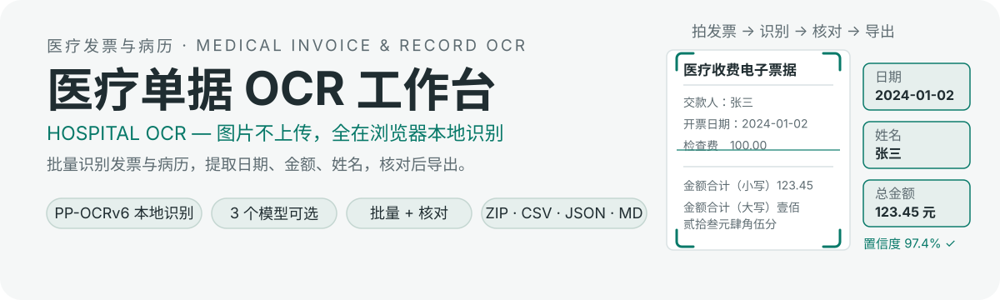
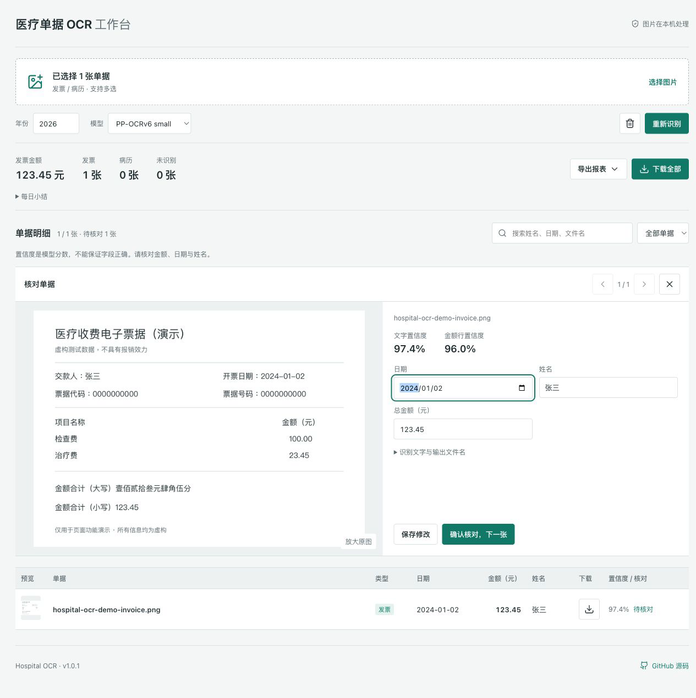

<p align="right"><a href="README.md">中文</a></p>

<p align="center">
  
</p>

<p align="center">
  <a href="https://hospital-ocr.xiaosang.cc/">▶ Use Online</a>
  ·
  <a href="https://github.com/holynova/hospital-ocr">GitHub Repository</a>
  ·
  <a href="./USAGE.md">User Guide</a>
</p>

Hospital OCR is a local-processing browser workbench for medical invoices and records. Drop in a batch of photos; it OCRs them with PaddleOCR PP-OCRv6 running in your browser (ONNX Runtime Web), extracts dates, totals, and names, corrects orientation, and lets you review each result against the source image before exporting. Images and results never leave your machine — recognition runs entirely locally, so private documents stay private. Models download once on first use; after that, it works offline.

## Screenshots

<p align="center">
  
</p>

<p align="center">
  
</p>

> All document data in the screenshots is fictional.

## Features

- **Local recognition**: PaddleOCR PP-OCRv6 runs in the browser (ONNX Runtime Web); images are never uploaded. 3 models to choose from: v6-small (default, high accuracy), v6-tiny, v5-mobile.
- **Batch jobs**: drag in multiple invoices or records to recognize in a batch, with pause, resume, and stop.
- **Orientation correction**: four-way adaptive deskew — sideways or upside-down photos are straightened before recognition.
- **Field extraction**: date, name, and total amount. Amounts prefer the invoice total and are cross-checked against the Chinese capital-amount text, with a warning when the two disagree.
- **Human review**: edit fields against the source image; confirming auto-advances to the next pending document. Edits sync to the filename, summary, and exported reports. Low confidence (<90%), an unreliable total, or missing key fields are flagged for attention.
- **Exports**: renamed-image ZIP, CSV, JSON, and Markdown reports, plus daily summaries.
- **Search & filter**: search by name, date, or filename; filter by pending / reviewed / unrecognized.

> Note: the confidence score is a model score, not the probability that a field is correct. Please verify amounts, dates, and names before use.

## Run Locally

```bash
python3 -m http.server 3001 --directory docs
# Open http://localhost:3001/
```

Or `npm start` (the same static server). Latest Chrome or Edge recommended; Windows, macOS, and Linux all work. No need to install Python PaddleOCR or set up a dedicated GPU.

## Tech

- Frontend: framework-free static `docs/` (HTML + CSS + JS), ONNX Runtime Web + `ppu-paddle-ocr` (PP-OCRv6), bundled with esbuild (`npm run build:bundle`).
- Extraction logic lives in `docs/js/extractors.js` (date / amount / capital amount / name / document classification), separated from the OCR engine and independently testable (`npm test`).
- A Python server implementation is also available (`server/`, FastAPI + PaddleOCR 3.7.0) with a CLI tool (`server/cli.py`) for offline batch processing.

```
docs/                    Browser version: index.html + js/ (ocr-engine, extractors, reports)
docs/js/ocr-engine.js    Pure-frontend inference engine (PP-OCRv6 + four-way deskew)
docs/js/extractors.js    Field extraction: date / amount / capital amount / name / classification
server/                  Python server (FastAPI + PaddleOCR) and CLI
tests/                   Frontend and backend tests (extractors, tasks, storage, web)
```
