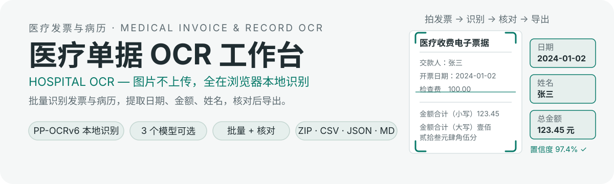
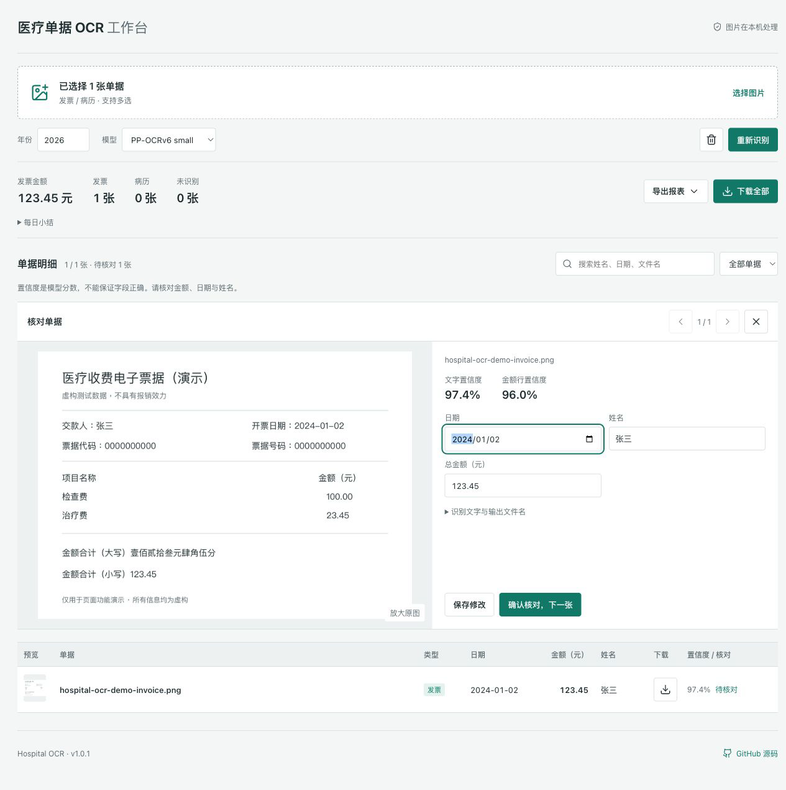

<p align="center">
  
</p>

<p align="center">
  <a href="https://hospital-ocr.xiaosang.cc/">▶ 在线使用 Try Online</a>
  ·
  <a href="https://github.com/holynova/hospital-ocr">GitHub 仓库</a>
  ·
  <a href="./USAGE.md">使用说明</a>
</p>

医疗单据 OCR 工作台：在浏览器本地批量识别医疗发票与病历图片，提取日期、金额、姓名，校正图片方向，按规则重命名并导出报表。图片和识别结果不上传任何服务器——识别全在你的浏览器里跑，隐私单据放心用。首次识别需联网下载一次模型，之后即可离线使用。

A browser workbench for medical invoices and records: batch OCR in the browser, extracting dates, totals, and names, correcting image orientation, and exporting renamed images with daily reports. Images and results never leave your machine — recognition runs entirely locally. Models download once on first use.

## 截图 / Screenshots

<p align="center">
  
</p>

<p align="center">
  
</p>

> 截图中的单据及字段均为虚构演示数据。All document data in screenshots is fictional.

## 功能 / Features

- **本地识别**：PaddleOCR PP-OCRv6 在浏览器内推理（ONNX Runtime Web），图片不上传；3 个模型可选：v6-small（默认，高精度）、v6-tiny、v5-mobile。
- **批量任务**：拖入多张发票/病历批量识别，支持暂停、继续、终止。
- **方向校正**：四方向自适应纠偏，横着拍、倒着拍都能正过来识别。
- **字段提取**：日期、姓名、总金额；金额优先取发票总额，并用中文大写金额交叉核对，大小写冲突时提示。
- **人工核对**：原图对照编辑字段，确认后自动进入下一张待核对单据；修改同步更新文件名、汇总与导出报表。置信度低于 90%、总额无法可靠识别或关键字段缺失时提示关注。
- **导出**：重命名图片 ZIP、CSV、JSON、Markdown 报表；每日小结。
- **筛选搜索**：按姓名、日期、文件名搜索；待核对 / 已核对 / 未识别筛选。

> 提醒：置信度是模型分数，不是字段正确的概率；金额、日期与姓名请核对后再使用。

## 本地运行 / Run Locally

```bash
python3 -m http.server 3001 --directory docs
# 打开 http://localhost:3001/
```

也可以 `npm start`（同样起静态服务器）。建议最新 Chrome 或 Edge；Windows、macOS、Linux 均可，不需要安装 Python PaddleOCR 或配置独立显卡。

## 技术 / Tech

- 前端：纯静态 `docs/`（HTML + CSS + JS，无框架），ONNX Runtime Web + `ppu-paddle-ocr`（PP-OCRv6），esbuild 打包（`npm run build:bundle`）。
- 提取逻辑在 `docs/js/extractors.js`（日期 / 金额 / 大写金额 / 姓名 / 单据分类），与 OCR 引擎分离，可独立测试（`npm test`）。
- 另有 Python 服务端实现（`server/`，FastAPI + PaddleOCR 3.7.0）与命令行工具（`server/cli.py`），适合批量离线处理。

```
docs/                    浏览器版：index.html + js/（ocr-engine、extractors、reports）
docs/js/ocr-engine.js    纯前端推理引擎（PP-OCRv6 + 四方向纠偏）
docs/js/extractors.js    字段提取：日期 / 金额 / 大写金额 / 姓名 / 分类
server/                  Python 服务端（FastAPI + PaddleOCR）与 CLI
tests/                   前后端测试（提取器、任务、存储、Web）
```

## English

**Hospital OCR** is a local-processing browser workbench for medical invoices and records. Drop in a batch of photos; it OCRs them with PaddleOCR PP-OCRv6 running in your browser (ONNX Runtime Web), extracts dates, totals, and names, corrects orientation, and lets you review each result against the source image before exporting.

- **Private by design**: images and results never leave your machine. Models download once on first use.
- **3 models**: v6-small (default), v6-tiny, v5-mobile.
- **Review workflow**: confidence scores with <90% flagged, Chinese capital-amount cross-check for totals, edit-and-confirm flow that auto-advances to the next pending document.
- **Exports**: renamed-image ZIP, CSV, JSON, and Markdown reports, plus daily summaries.
- **Tech**: framework-free static frontend in `docs/`; Python FastAPI + PaddleOCR backend in `server/` for offline batch use. `npm test` runs the standalone module tests.

## 许可 / License

ISC（见 `package.json`）。ISC (see `package.json`).
