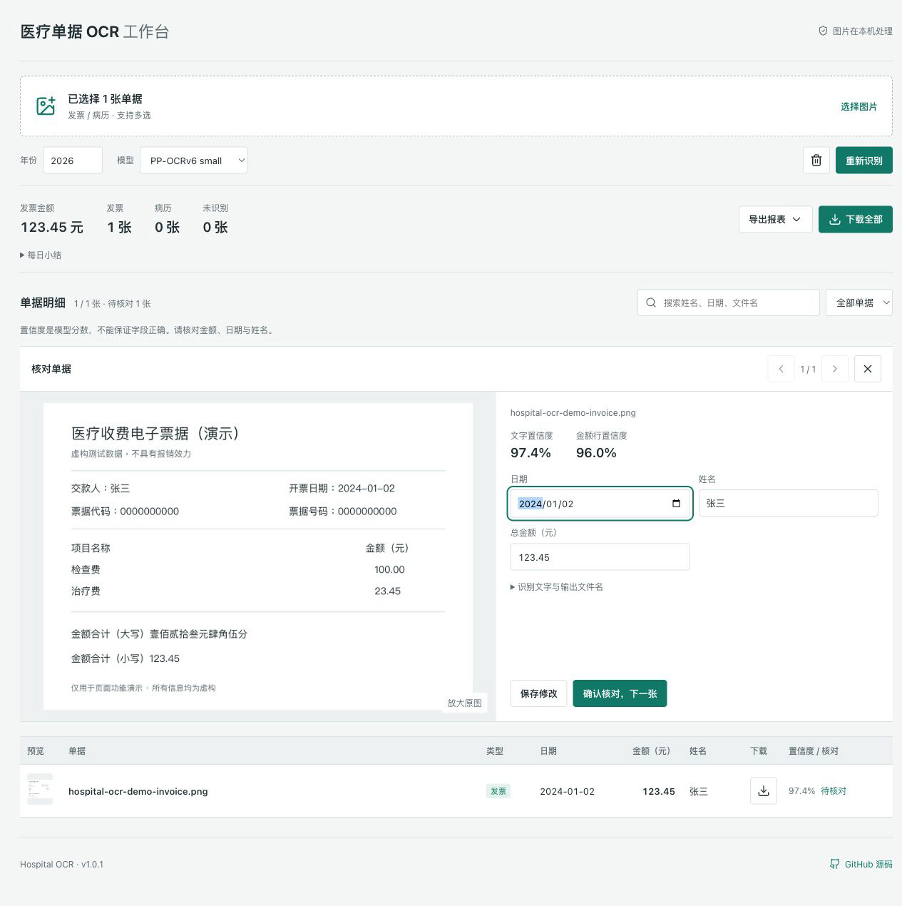

# Hospital OCR / 医疗单据工作台

中文：在浏览器本地批量识别发票与病历，提取日期、金额、姓名，校正方向并重命名图片。支持原图对照、置信度提示、人工核对及每日统计，导出 ZIP、CSV、JSON、Markdown。Windows、macOS、Linux 均可使用。首次加载需联网下载模型；模型分数不代表字段正确率，请核对后使用。

English: A local-processing browser workbench for medical invoices and records. Extract dates, totals and names, correct image orientation, review OCR confidence beside the source, edit fields and export renamed images with daily reports. Works on Windows, macOS and Linux. Models download on first use; confidence is not a guarantee of correctness.



## 在线体验 / Live Demo

- [Cloudflare Demo](https://hospital-ocr.xiaosang.cc/)（待上线验证 / pending verification）
- [GitHub Repo](https://github.com/holynova/hospital-ocr)
- [使用说明 / Usage](./USAGE.md)


## 本地运行 / Run Locally

```bash
python3 -m http.server 3001 --directory docs
```

打开 / Open `http://localhost:3001/`。

## 测试与发布 / Test and Deploy

```bash
npm ci
npm test
npm run deploy:check
npm run deploy
```

Cloudflare Workers Static Assets · `hospital-ocr.xiaosang.cc` · v1.0.1

仅从 `main` 在本地手动部署 Cloudflare；已有 GitHub Pages 保留作回退。域名使用精确 Worker Route，因区域 Custom Domains 配额已满。

Deploy manually from `main`. The existing GitHub Pages site remains a fallback. An exact Worker Route serves the custom hostname.

图片和识别结果不上传识别服务器。页面使用 Umami 统计访问，不主动发送单据内容。截图中的单据及字段均为虚构演示数据。

Images and OCR results are processed locally. Umami records page visits; the application does not send document contents to analytics. All document data in screenshots is fictional.
